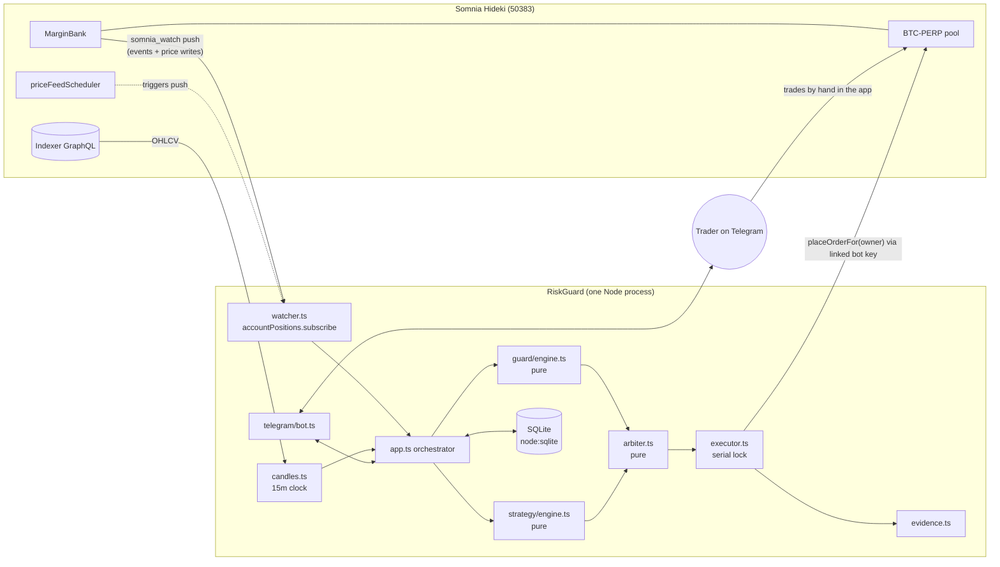

# RiskGuard: architecture, decisions, results

RiskGuard is a Telegram-controlled liquidation guard for dreamDEX perps on Somnia (Hideki testnet, chain 50383). The trader links a bot key in the app ("Link a Bot") and keeps trading by hand. RiskGuard watches the account every block. As health falls it warns, then trims, then flattens, always reducing and never opening. A deterministic strategy (breakout or EMA trend) is an optional second mode, and the same guard protects its positions.

Product spec: [DESIGN.md](DESIGN.md) (v3, guard-first). This file covers how the code is built, why, and what has been verified.

## 1. System



### What happens on each tick
1. **Push.** Somnia Reactivity pushes a one-block account read (positions, marks, liquidation price, equity, mmReq). It fires on MarginBank events and on every price write. If nothing arrives for 15 s, the watcher reads the account itself every 5 s.
2. **Adopt.** A BTC position RiskGuard didn't open is tagged `manual` and gets guarded. One the strategy opened within the last 60 s is tagged `strategy` and gets its bracket TP/SL.
3. **Guard.** `evaluateGuard(snapshot, rules, ctx, state)` returns at most one action (flatten > trim > strategy SL/TP > warn) plus any alert. It's a pure function: no IO, no clock reads, fully unit-tested.
4. **Act.** The executor sizes the close from `previewPerpClosePnl(...).closedQuantity` at the current block. It sends an opposite-side MARKET (IOC) order through the linked key and widens slippage on a no-fill (flatten ladder 1×, 2×, 4×, 8× capped at 200 bps). Every attempt goes to SQLite and `evidence/txs.jsonl`, hash included.
5. **Tell.** Telegram gets the action, health before and after, the tx link and a share button.

The strategy runs on its own clock, 20 s after each 15-minute candle closes. `decide()` is pure too, and the arbiter only lets it open when there's no position and the guard has no blocks.

### Module map
| Layer | Files | Notes |
|---|---|---|
| Pure core | `rules.ts`, `guard/trigger.ts`, `guard/engine.ts`, `strategy/*`, `params.ts`, `arbiter.ts` | No IO; 59 tests |
| Chain IO | `chain.ts`, `watcher.ts`, `candles.ts`, `executor.ts`, `vendor/perp-core/` | Only place that touches the SDK |
| State | `db.ts`, `evidence.ts` | SQLite + JSONL tx log |
| Orchestration | `app.ts`, `index.ts` | Wiring, cooldown clocks, health checks, daily recap |
| UX | `telegram/bot.ts` | grammY, inline keyboards |
| Ops | `scripts/doctor.ts`, `scripts/keygen.ts`, `scripts/evidence.ts` | Preflight, key generation, EVIDENCE.md |

## 2. Architecture decisions

Each decision gives the context, what we chose, and what it costs.

### ADR-1 Guard-first, strategy second
- **Context:** Most perp bots compete on entries. Liquidation is where retail traders lose the most, and a 20x BTC long on a 10 ms chain can be wiped out between two glances at a phone.
- **Decision:** The product is the guard on positions the trader opens by hand. The strategy is optional and sits under the same guard.
- **Cost:** Our value depends on the linked bot being able to reduce a manually opened position. Positions net per margin account, so it should work. Section 4 has the one-trade spike that proves it.

### ADR-2 Reduce-only by construction
- **Context:** Perp orders have no reduce-only flag, and a linked operator with "place" permission can open new risk ([feedback/002](feedback/002-no-reduce-only-for-operators.md)).
- **Decision:**
  - Every guard order is opposite-side, sized from `previewPerpClosePnl.closedQuantity` at the current block, behind a serial lock.
  - The arbiter never turns a guard action into an open or an add.
  - The strategy can only open when the account holds no position.
- **Cost:** This is enforced off-chain. If the position changes between sizing and fill, the order can overshoot. Closing at the current block and the serial lock keep that window small.

### ADR-3 Health = equity / maintenance requirement, with closed-form trigger prices
- **Context:** Traders think in prices, the protocol in margin.
- **Decision:** `health = equity / mmReq`, so 1.0 means liquidation. For each level h, we solve `E + q(P − P0) = h·(mmRate·|q|·P + mmOther)` for P. That gives each level a concrete trigger price to show the trader at arm time. Other markets' maintenance (`mmOther`) is kept, so cross-margin accounts are correct.
- **Result:** On live accounts the h = 1 solve matches the chain's own liquidation price to 0.1 USD for both a long and a short (section 3).

### ADR-4 Three tiers, hysteresis, cooldowns, idempotency
- **Decision:**
  - Levels are warn, then trim (25–50%), then flatten.
  - A level re-arms only after health recovers by 0.1.
  - Cooldowns: flatten 3 s, trim 20 s, SL/TP 5 s.
  - Each action has the idempotency key `level:block`.
  - At most 6 actions per hour.
  - Snooze only silences trims, never flatten.
  - Guard state is checked before a level is disarmed, so a skipped action never eats the level.
- **Why:** On 10 ms blocks with pushes on every price write, a naive threshold check would fire dozens of orders a second. These limits make the guard act once per real crossing.

### ADR-5 Volatility-aware buffer (ATR)
- **Decision:** Besides the health thresholds, the guard trims or flattens when the distance to liquidation drops below ATR(14, 15m) × a profile multiple (Balanced: trim at 2× ATR, flatten at 1× ATR).
- **Why:** Testnet BTC moved about 1.04% per 15 minutes when we measured. A fixed health threshold that suits a calm hour is too late in a fast one.

### ADR-6 Somnia Reactivity first, polling as fallback
- **Decision:** `accountPositions.subscribe` with the **Hideki** address set (it includes Hideki's `priceFeedScheduler`), so the node pushes on every price write. A 5 s self-read starts only if pushes stop for 15 s. `/status` shows the source (reactivity or poll), updates per minute and data age. Data older than 30 s blocks new strategy entries. Reductions are still allowed, because each close is re-sized from the chain when it's sent.
- **Finding:** The bot kit's `createExchange` passes the Shannon address set while connected to Hideki. Pushes then quietly degrade to the SDK's read loop ([feedback/001](feedback/001-kit-uses-shannon-addresses-on-hideki.md)).

### ADR-7 Never trust the indexer's market-row mark for decisions
- **Decision:** Guard decisions use the account view's per-block `marks.markPrice`. Order sizing uses the pool's live mark.
- **Why:** The row lagged the live mark by 0.82% when measured ([feedback/004](feedback/004-market-row-mark-lags.md)).

### ADR-8 Deterministic strategy, no LLM in the trading path
- **Decision:**
  - Two presets: Breakout (prior completed 1h high/low ± 0.05%) and Trend (EMA 9/21 cross).
  - Closed candles only: the newest bucket is dropped until it closes. 30-candle warm-up.
  - One decision per candle, stored with a `UNIQUE(candle_ts)`, so a restart can't double-trade.
  - Daily trade and loss limits.
  - Leverage is capped as effective leverage (`sizeUsd / equity`), because the protocol's leverage setting is per account, not per order.
- **Why:** Reproducible, testable, explainable in one Telegram line.

### ADR-9 Single tenant for the MVP
- **Decision:**
  - One deployment holds one owner address, one bot key and an allowlist of chat IDs.
  - The bot key can trade for the owner but can't withdraw.
  - Any 64-hex string posted in chat is deleted and the sender is warned.
  - No key is ever requested over Telegram.
- **Cost:** Each trader runs their own instance. Multi-tenant (many owners linking the same bot, proven by a small STT tx) is designed in DESIGN.md §4 and deferred until it's verified on chain.

### ADR-10 Dependencies kept to what runs a 24/7 bot
- **Decision:**
  - `node:sqlite` (built into Node ≥ 22.13: no native build, works on any host).
  - grammY with plain inline-keyboard state, not the conversations plugin (fewer moving parts across restarts).
  - zod for config and rule validation.
  - Kit `perp-core` vendored with its LICENSE ([feedback/003](feedback/003-perp-core-not-published.md)).
  - Two local changes in the vendored code: `placePerp` returns the tx hash, and `closePosition` takes a slippage override.
- **Safety defaults:** `DRY_RUN=true`, `MAX_ORDER_USD=100`, and the process refuses to start if the chain id isn't 50383.

## 3. Results so far

### Unit tests: 59/59 passing (`npm test`, ~200 ms)
| Suite | What it pins down |
|---|---|
| `trigger.test.ts` | Trigger prices round-trip to their health level for longs and shorts; cross-margin maintenance; trim maths (25% at health 1.5 → 2.0); **live-chain regression: liq 73,916.1** |
| `guard.test.ts` | Exact threshold edges for all 3 profiles, alert vs protect mode, hysteresis and re-arm, idempotency per block, flatten retry cooldown, 6/hour limit, snooze never blocks flatten, ATR buffer, SL/TP only on strategy positions, stale data / low gas / broken link / daily limit block entries, determinism |
| `strategy.test.ts` | EMA/ATR, breakout uses only completed 1h candles, trend cross, warm-up, stands aside for manual positions, daily limits, determinism, param validation, arbiter (guard outranks strategy, never closes a manual position) |
| `rules.test.ts` | Profile validation (gaps ≥ 0.2, flatten ≥ 1.05), canonical hashes |

### Live read-only checks against Hideki (`npm run doctor`, 2026-10-30 ~20:05 WAT)
```
✅ chain 50383 · DRY RUN
✅ BTC-PERP: pool 0x4181dd08…94c0 · marginBank 0x478769e1…1394 · base 8d · quote 18d · tick 0.1 · lot 0.00001 · min 0.00013 BTC · IM 5%
✅ live mark 76378.06 (market row says 77008.23)
✅ 59 closed 15m candles · ATR(14) 1.036%
```
Guard maths on two real accounts holding BTC-PERP positions (public on-chain state, read-only):
```
long 0.2471 BTC @ 82010 · mark 76473.91 · notional 18896.70 · equity 1088.65 · mmReq 472.42 · health 2.304
balanced triggers: warn 75861.3 · trim 74876.1 · flatten 74201.5 · liq 73916.1 (chain liq 73916.1)

short 0.34685 BTC @ 81935.62 · mark 76463.23 · notional 26521.27 · equity 7578.76 · mmReq 1069.97 · health 7.083   (3-market cross account)
balanced triggers: warn 91397.2 · trim 93063.8 · flatten 94254.5 · liq 94771.0 (chain liq 94771.0)
```
This checks four things against the live chain:
- price and size scaling (view mark vs live mark within 0.01%)
- the account-view field mapping
- the liquidation solve for both sides
- cross-margin accounts

### Feedback filed
Four items in [feedback/](feedback/): the kit's Hideki address set (major), no reduce-only for operators, perp-core unpublished, and the stale market-row mark.

## 4. Still to prove on chain (needs the trader's keys)
1. **Spike (most important):** open a minimum-size BTC long by hand in the app, then `/close 50` from Telegram. Done when the position halves and the tx hash is logged. This proves ADR-1.
2. **Guard saves:** at least 3 guard actions (warn, trim, flatten) on a real 15–20x manual position, each with a hash in `evidence/txs.jsonl` and `EVIDENCE.md` (`npm run evidence`).
3. **Strategy:** at least 4 strategy orders with their candle reasons.
4. Run 24/7 on a VPS or Railway with `DRY_RUN=false`.

## 5. Run it
```bash
npm i
cp .env.example .env          # OWNER_ADDRESS, TELEGRAM_BOT_TOKEN, ALLOWED_CHAT_IDS
npm run keygen                # bot key → .env only; link its address in the app, send it some STT
npm run doctor                # preflight: chain, market, candles, link, gas, account, triggers
npm run dev                   # DRY_RUN=true by default; set DRY_RUN=false to trade
npm test && npm run typecheck
```
