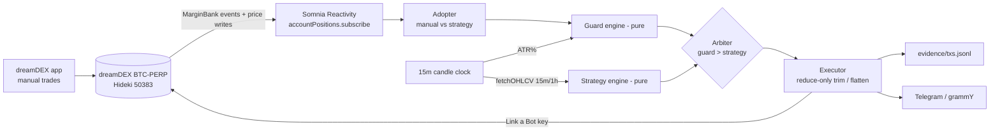
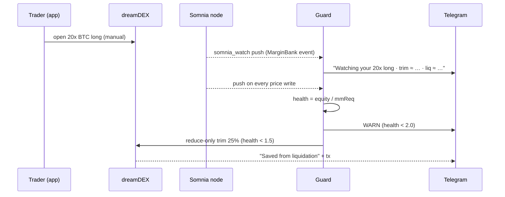

# RiskGuard

> Built for [dreamDEX Perps Builder Bounty](https://dorahacks.io/hackathon/{{BOUNTY_SLUG}}) · MVP track · Trader tools + Bots & Agents

**A Telegram liquidation guard for your dreamDEX BTC-PERP position. Keep trading in the app; RiskGuard watches your account through Somnia Reactivity on every price update and trims or flattens before you get liquidated. An optional 15-minute strategy runs under the same guard.**

     

## Reviewing this? Start here

Verify in 60 seconds, in order of how much each proves:

| | |
|---|---|
| **The guard saved a real position** | A {{LEVERAGE}}x long opened manually in the app, trimmed by the bot: health {{HEALTH_BEFORE}}x → {{HEALTH_AFTER}}x, liq {{LIQ_BEFORE}} → {{LIQ_AFTER}}, tx [{{TX_GUARD_SHORT}}]({{EXPLORER_TX_GUARD}}) |
| **It places real perps orders** | [Evidence](#evidence): {{TX_COUNT}} testnet txs on the Somnia explorer ({{GUARD_TX_COUNT}} guard actions, {{STRATEGY_TX_COUNT}} strategy orders) |
| **It uses Somnia primitives** | `/status` prints `source: reactivity` (off-chain Reactivity, `somnia_watch`, pushed on every price-feed write) + Link a Bot. See [stack](#somnia--dreamdex-stack-used) |
| **It's deterministic** | Every action message shows its reason and numbers; `npm test` covers every guard threshold and the same-input → same-decision strategy tests ({{TEST_COUNT}} tests) |
| **Try it** | Bot: {{TELEGRAM_BOT_LINK}} · Demo: {{DEMO_VIDEO_URL}} · Repo: https://github.com/0xGp/risker |

## Demo video
[]({{DEMO_VIDEO_URL}}) · 3 min · script in [DEMO.md](submission-kit/DEMO.md)

## Screenshots
| `/guard` profile | Confirm card (trigger prices) | Position adopted | Guard trim | Saved card | Explorer tx |
|---|---|---|---|---|---|
| {{SCREENSHOT_GUARD_WIZARD}} | {{SCREENSHOT_CONFIRM}} | {{SCREENSHOT_ADOPT}} | {{SCREENSHOT_TRIM}} | {{SCREENSHOT_CARD}} | {{SCREENSHOT_EXPLORER}} |

**Contents:** [Problem](#problem) · [How it works](#how-it-works) · [Architecture](#architecture) · [Stack](#somnia--dreamdex-stack-used) · [Guard rules](#guard-rules) · [Strategy](#optional-strategy) · [Safety](#safety) · [Evidence](#evidence) · [Quickstart](#quickstart) · [Tests](#tests) · [Layout](#repo-layout) · [Status](#honest-status) · [X posts](#x-posts) · [Credits](#credits)

## Problem
At 20x on BTC-PERP, a ~2.5% move liquidates you, and liquidation charges up to 1% of the notional closed. A single 15-minute wick can do it while you're at work. Price alerts still need you to act, exchange TP/SL is blunt, and LLM "agents" are unpredictable with money.

**Who it's for:** Telegram-native retail traders (e.g. the Nigerian crypto community) and Perps Arena traders who trade manually with leverage from their phone.

## How it works
1. **Link once:** link the bot's address in the dreamDEX app (Link a bot). It can place and reduce orders for you; it can never withdraw.
2. **Pick a guard with buttons:** `/guard` → Conservative / Balanced / Aggressive → Alert only or Protect → a confirm card showing the exact BTC prices where it will warn, trim and flatten.
3. **Trade in the app as usual.** On the first Reactivity push showing a BTC-PERP position, the bot adopts it and posts its trigger prices.
4. **Guard loop:** Somnia Reactivity pushes your account state on every price write. Health < warn → alert. Health < trim → reduce-only trim. Health < flatten → reduce-only close. Every action comes with its reason and tx link, plus a "Saved from liquidation" card.
5. **Optional strategy:** `/strategy` → Breakout or Trend → wizard → confirm. A pure `decide()` runs on every closed 15m candle. The guard always outranks it, and it never touches a position you opened yourself.

## Architecture




## Somnia × dreamDEX stack used
| Call | Use |
|---|---|
| `new SomniaMarkets({ chain: hidekiTestnet, indexerUrl, addresses: SOMNIA_HIDEKI_TESTNET_ADDRESSES, privateKey })` | client (`@somnia-chain/markets-sdk@0.32.1`) |
| `client.listPerpMarkets()` → `baseSymbol === "BTC"` | market row (`poolAddress`, `marginBank`, decimals) |
| `client.accountPositions.subscribe(marginBank, owner, onView)` | **Reactivity** (`somnia_watch`) guard feed |
| `fetchOHLCV("BTC/USDso:USDso", "15m" \| "1h")` | ATR for the guard, candles for the strategy |
| `client.getMarginAccount`, `client.getMaxPerpOrderSize` | health, sizing |
| perp-core `marginSnapshot`, `healthRatio`, `positionIn`, `sizeOrder`, `placePerp`, `closePosition`, `linkCoverage` | execution (from the dreamDEX bot kit) |
| Link a Bot (perp-core linked mode, `OWNER_ADDRESS` set) | non-custodial bot key: trade/reduce, never withdraw |

## Guard rules
| Profile | Warn | Trim | Flatten | Trim size |
|---|---|---|---|---|
| Conservative | 2.5 | 1.8 | 1.3 | 50% |
| **Balanced** (default) | 2.0 | 1.5 | 1.15 | 25% |
| Aggressive | 1.6 | 1.3 | 1.1 | 25% |

`health = equity / maintenance margin` (1.0 = liquidation). Trim and flatten also fire when the liq distance gets within 2× / 1× the 15m ATR (Balanced). Modes: **Protect** (acts) or **Alert only** (buttons). The guard only ever reduces a position; it never opens, adds or flips. `/snooze` pauses trims for 15 minutes; flatten can't be snoozed.

## Optional strategy
| Preset | Long | Short | Exit |
|---|---|---|---|
| Breakout | close > prior 1h high +buffer | close < prior 1h low −buffer | TP/SL or opposite signal |
| Trend follow | EMA9 crosses above EMA21 | crosses below | TP/SL or opposite cross |

Params: size (USDso), leverage cap 2/3/5x, TP%, SL%, max trades/day, daily loss limit, direction. Runs only when no position is open; blocked by any guard block.

## Safety
The linked bot key **cannot withdraw** · the guard is reduce-only and never fights you · secrets env-only, keys never accepted in chat (auto-deleted) · chat allowlist {{OR_ONCHAIN_OWNERSHIP_PROOF}} · confirm on arm, `/close`, `/panic` and guard-off · caps on size, strategy leverage ≤ 5x, actions/hour, daily loss · `DRY_RUN=true` default · refuses any chain other than 50383 · no LLM in the trading path.

## Evidence
| # | Time (WAT) | Kind | Position | Health / liq before → after | Tx |
|---|---|---|---|---|---|
| 1 | {{TIME}} | guard trim (manual position) | {{LEV}}x {{SIDE_QTY}} | {{H1}} → {{H2}} · {{L1}} → {{L2}} | [{{TX_SHORT}}]({{EXPLORER_TX}}) |
| 2 | {{TIME}} | guard flatten (manual position) | {{LEV}}x {{SIDE_QTY}} | {{H1}} → closed | [{{TX_SHORT}}]({{EXPLORER_TX}}) |
| 3 | {{TIME}} | strategy entry ({{PRESET}}) | {{SIDE_QTY}} | reason: {{REASON}} | [{{TX_SHORT}}]({{EXPLORER_TX}}) |
| 4 | {{TIME}} | strategy exit (TP/SL) | {{SIDE_QTY}} | reason: {{REASON}} | [{{TX_SHORT}}]({{EXPLORER_TX}}) |
| 5 | {{TIME}} | /panic | {{SIDE_QTY}} | user | [{{TX_SHORT}}]({{EXPLORER_TX}}) |

Full log: [EVIDENCE.md](EVIDENCE.md) (generated by `npm run evidence`). Bot wallet: `{{BOT_WALLET_ADDRESS}}` · Owner wallet: `{{OWNER_WALLET_ADDRESS}}`.

## Quickstart
```bash
git clone https://github.com/0xGp/risker && cd risker && npm i
cp .env.example .env   # BOT_PRIVATE_KEY (fresh EOA), OWNER_ADDRESS, TELEGRAM_BOT_TOKEN, ALLOWED_CHAT_IDS
# app.testnet.dreamdex.io → wallet → Link a bot → paste the bot address → Perps → Add bot
npm run doctor         # market, mark, last 3 closed 15m candles, link coverage, STT, your position + trigger prices
npm run dev            # DRY_RUN=true; set false to act
```

## Tests
`npm test`: {{TEST_COUNT}} tests (every guard threshold per profile/mode/origin, hysteresis + idempotency, trigger-price round-trips, validators, both presets on fixtures + determinism, arbiter priority, "strategy never touches a manual position").

## Repo layout
```
src/ config.ts rules.ts params.ts adopter.ts arbiter.ts candles.ts watcher.ts executor.ts evidence.ts db.ts
     guard/{engine,trigger}.ts  strategy/{engine,indicators}.ts  telegram/  vendor/perp-core/
test/  evidence/  feedback/  EVIDENCE.md  DESIGN.md  submission-kit/
```

## Honest status
- ✅ Works: {{WORKING_LIST}}
- ⚠️ Limits: BTC-PERP only; {{SINGLE_OR_MULTI_TENANT}}; the guard can only reduce (a linked key can't add margin or change leverage, so it links you to the app); it needs uptime, so also set exchange TP/SL; trimming realizes a loss that a bounce would have recovered.
- 🧪 Not built: {{NOT_BUILT_LIST}}
- 🚀 Mainnet: chain, RPC and addresses come from config; switching to perps mainnet is a config change.

## X posts
1. {{X_POST_1_URL}}: what it does (guard on a manual position)
2. {{X_POST_2_URL}}: a real save, with the tx
3. {{X_POST_3_URL}}: determinism + Reactivity + Link a Bot thread

## Feedback
SDK and bot-kit issues found while building are in [`feedback/`](feedback/) (one file per issue, bounty Feedback-track format) and summarized in [SDK_FEEDBACK.md](submission-kit/SDK_FEEDBACK.md).

## Credits
[dreamDEX bot kit](https://github.com/somnia-chain/dreamdex-bot-kit) (perp-core, MIT) · `@somnia-chain/markets-sdk` · Somnia Reactivity · grammY. AI tools: {{AI_TOOLS_USED}}. Testnet only; not financial advice.
